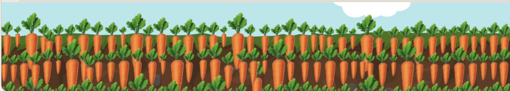

{fig-align="center"}

## Description

Connect the dots between the population, sample, and bootstrap sample with this interactive applet.

A farmer has been tending to a large field of carrots and would like to evaluate their growth. The farmer is only willing to give you 30 random carrots to assess their growth.

**This applet and associated activity was tested with small group of undergraduate students.**

## Learning outcomes:

After the activity, students will be able to:

-   Identify that bootstrapping involves sampling with replacement

-   Calculate bootstrap sample means/proportions

-   Compare and contrast the population, sampling, and bootstrap distributions

-   Construct and interpret 95% plausible ranges

## Materials Needed

-   Activity: <a href="activity.pdf" class="btn btn-outline-primary btn-sm" download>Download Activity PDF</a> <a href="activity.qmd?raw=true" class="btn btn-outline-primary btn-sm" download="activity.qmd">Download Activity Source File (.qmd)</a>

-   Link to Applet: <https://grcetmpk.shinyapps.io/bootstrap_dsci100/>

*If you'd like to edit the activity, download and edit the source file.*

## Directions

1.  Provide students with the link to the applet and the activity
2.  (Optional) Do Part 1 together in class
3.  Allow students to work through the rest of the activity in pairs!

## Student Feedback

-   *"I was satisfied with this app because it seemed like it was meant to be a visual approach to learning"*

-   *"I like that you can see some of the samples were drawn with replacement quite clearly"*

-   *"\[using only the\] Jupyter worksheets \[and not the applet\], I had misconceptions about the whole concept at first"*

-   *"It's nice that the worksheet tells you the record the means"*
